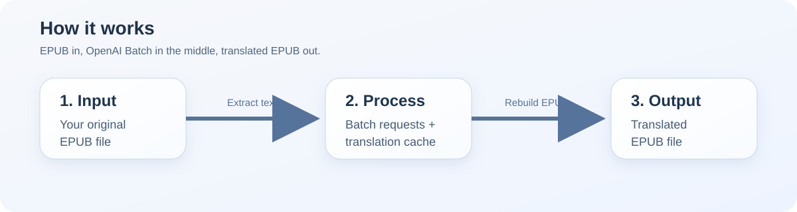

# translate-epub-ai

Traduce libros EPUB con OpenAI o Anthropic de forma sencilla y con comandos fáciles de copiar y pegar.

[Read in English](README.md)



## La versión corta

Si solo quieres la ruta rápida:

1. Instala el proyecto.
2. Configura tu API key.
3. Ejecuta un comando.

```bash
pip install -e .
python -m translate_epub_ai "book.epub" --to es
```

Salida:

```text
book_ES.epub
```

## Qué hace esta herramienta

Le das un archivo EPUB.

La herramienta:

- abre el EPUB de forma segura
- encuentra el texto legible
- envía los trabajos de traducción mediante una API batch
- mantiene la estructura original del EPUB
- genera un EPUB traducido
- guarda progreso para poder reanudar más tarde

## Qué necesitas

- Python 3.10 o superior
- una API key de OpenAI o de Anthropic

## Instalar

Abre una terminal en la carpeta del proyecto y ejecuta:

```bash
pip install -e .
```

## Configurar tu API key

OpenAI en PowerShell:

```powershell
$env:OPENAI_API_KEY="tu_api_key_aqui"
```

Anthropic en PowerShell:

```powershell
$env:ANTHROPIC_API_KEY="tu_api_key_aqui"
```

OpenAI en Command Prompt (`cmd`):

```cmd
set OPENAI_API_KEY=tu_api_key_aqui
```

Anthropic en Command Prompt (`cmd`):

```cmd
set ANTHROPIC_API_KEY=tu_api_key_aqui
```

macOS / Linux:

```bash
export OPENAI_API_KEY="tu_api_key_aqui"
```

Anthropic en macOS / Linux:

```bash
export ANTHROPIC_API_KEY="tu_api_key_aqui"
```

## Traducir tu primer libro

Ejemplo básico:

```bash
python -m translate_epub_ai "book.epub" --to es
```

Ejemplo indicando modelo:

```bash
python -m translate_epub_ai "book.epub" --to es --model gpt-5.6-terra
```

Ejemplo con Anthropic:

```bash
python -m translate_epub_ai "book.epub" --provider anthropic --model claude-sonnet-5-5 --to es
```

## Comandos útiles

Preparar todo pero sin enviar todavía el batch:

```bash
python -m translate_epub_ai "book.epub" --to es --prepare-only
```

Reanudar un batch que ya existe:

```bash
python -m translate_epub_ai "book.epub" --resume-batch-id batch_123
```

Importante:

- si no indicas `--provider`, seguirá usando `openai`
- `python -m translate_epub_ai` es ahora el comando directo recomendado
- la caché y la reanudación siguen evitando llamadas repetidas y gasto extra de tokens

Usar tu propio archivo de prompt:

```bash
python -m translate_epub_ai "book.epub" --to es --prompt-file my_prompt.txt
```

La reparación automática está activada por defecto:

- después del batch principal, la herramienta hace una pasada editorial de revisión por bloques
- después del batch principal de traducción
- la herramienta busca fragmentos sospechosos
- vuelve a traducir automáticamente solo esos fragmentos
- y luego construye el EPUB final

Así que en el uso normal no tienes que revisar todo el libro manualmente solo para disparar reparaciones.

Reparar solo frases o párrafos concretos que han quedado mal:

```bash
python -m translate_epub_ai "book.epub" --to es --repair-file repair.json
```

Ejemplo de `repair.json`:

```json
[
  "The original English sentence that needs a better translation.",
  {
    "source_text": "A difficult paragraph from the source book.",
    "context_hint": "This section is technical and should sound precise but natural."
  }
]
```

## ¿Quieres mejorar el estilo de traducción?

El prompt por defecto está aquí:

```text
src/translate_epub_ai/prompts/default_prompt.txt
```

Puedes:

- editar ese archivo directamente
- pasar tu propio archivo con `--prompt-file`

Así puedes mejorar tono, estilo y fluidez sin tocar el código Python.

Si algunas frases traducidas salen rotas, forzadas o poco naturales, la herramienta ahora intenta repararlas automáticamente en la misma ejecución.

`--repair-file` sigue existiendo como opción avanzada cuando quieres forzar reintentos selectivos sobre fragmentos concretos.

También puedes controlar la revisión editorial incorporada:

```bash
python -m translate_epub_ai "book.epub" --to es --review-passes 1
```

## Traducir en local con Ollama (gratis, sin API key)

1. Instala Ollama: <https://ollama.com/download> (Windows: `winget install Ollama.Ollama`).
2. Descarga un modelo, por ejemplo:

```bash
ollama pull gemma4:26b-a4b-it-qat
```

3. Traduce:

```bash
python -m translate_epub_ai "libro.epub" --provider ollama --glossary glossaries/the-beginning-of-infinity.es.txt --to es
```

Notas:

- Las peticiones se ejecutan una a una en tu equipo, así que un libro entero puede tardar horas. Se muestra el progreso y el tiempo estimado.
- Si se interrumpe, vuelve a lanzar el mismo comando: los párrafos terminados están en la caché de progreso y no se traducen dos veces.
- `--review-passes 0` se salta la segunda pasada de revisión y reduce el tiempo a la mitad.
- `--glossary glossaries/the-beginning-of-infinity.es.txt` fuerza una terminología coherente. Solo se envían los términos que aparecen en cada petición. Para otros libros puedes escribir tu propio glosario (una línea `original = traducción`).
- Modelo recomendado para una GPU de 16 GB: `gemma4:26b-a4b-it-qat` (mezcla de expertos, ~4B parámetros activos, así que es rápido). Con GPUs más pequeñas, `gemma4:12b`. El modo de razonamiento se desactiva automáticamente para ganar velocidad.
- Para español, el prompt añade reglas de estilo concretas (comillas « », pasiva refleja, no omitir matices, evitar calcos) y las comillas se normalizan a « » automáticamente.
- Variables de entorno opcionales: `OLLAMA_HOST` (por defecto `http://localhost:11434`), `OLLAMA_NUM_CTX` (por defecto `16384`), `OLLAMA_TEMPERATURE` (por defecto `0.3`).

## Glosarios (para cualquier libro)

Un glosario mantiene coherentes los términos clave en todo el libro.

```bash
# 1. Genera un glosario inicial para el libro y para, para que lo revises
python -m translate_epub_ai "libro.epub" --provider ollama --to es --glossary-only
# 2. Edita libro.glossary.es.txt y traduce con él
python -m translate_epub_ai "libro.epub" --provider ollama --to es --auto-glossary
```

`--auto-glossary` busca términos candidatos en local (palabras que el autor enfatiza, nombres de conceptos con mayúscula, expresiones recurrentes) y pregunta al modelo cuáles son términos de verdad y cómo traducirlos. Si el archivo ya existe se reutiliza, así que tus cambios se conservan.

Formato, una entrada por línea (`#` inicia un comentario):

```text
hard to vary = difícil de variar
reach = alcance | the range of situations an idea applies to, not "reach out"
```

Lo que va tras `|` indica al modelo en qué sentido se aplica la traducción, para palabras que también tienen un uso corriente. Solo se envían los términos que aparecen en cada petición. `glossaries/the-beginning-of-infinity.es.txt` es un ejemplo hecho a mano.

## Revisión: dónde están los puntos débiles

Tras la primera pasada, un comprobador local (sin llamar al modelo) busca puntos débiles y solo se revisan esos párrafos (`--review-scope flagged`, por defecto). Marca:

- marcadores de formato que no coinciden con el original;
- párrafos mucho más cortos o largos de lo habitual en este libro (posible omisión o paráfrasis);
- palabras idénticas al original (fragmentos sin traducir);
- números que faltan o cambian; un número de frases muy distinto (contenido perdido o fusionado);
- palabras repetidas, comillas o paréntesis desparejados, términos del glosario no usados;
- párrafos que empiezan remitiendo al anterior («This…», «But…», «So…»): las costuras donde se puede romper la coherencia;
- párrafos en los que el propio modelo traductor declaró una duda.

El revisor recibe el original, la traducción actual, la traducción ya aprobada del párrafo anterior (para comprobar que se lee como continuación) y los motivos del aviso. Usa `--review-scope all` para revisar todo, `--review-passes 0` para saltarte la revisión y `--review-existing` para revisar un libro ya traducido.

## Citas, bibliografía e índice

- Los títulos de obras citadas y los nombres de personas nunca se traducen.
- Se detectan las secciones de bibliografía y lecturas recomendadas (por nombre de archivo o título, en varios idiomas): autores, títulos, editoriales y fechas se quedan como en el original.
- Las entradas del índice alfabético se traducen como términos de índice, conservando nombres y números. `--skip-index` deja el índice sin traducir para ahorrar tiempo.

## Proveedores por API

- Por defecto: `gpt-5.6-terra` (OpenAI) y `claude-sonnet-5-5` (Anthropic). Opciones más baratas: `--model gpt-5.6-luna` o `--model claude-haiku-5-5`.
- Caché de prompt: las instrucciones fijas van primero e idénticas en cada petición (`prompt_cache_key` en OpenAI, `cache_control` en Anthropic), así que a partir de la primera se cobran a precio de caché. Ollama reutiliza ese mismo prefijo para no volver a leerlo.
- En los modelos GPT-5.6 de OpenAI se desactiva el razonamiento oculto (`--reasoning-effort none`): traducir no lo necesita y se cobra como salida. Usa `--reasoning-effort low` (o `default`) para cambiarlo.

## Cómo se envía el texto al modelo

Cada párrafo o título se traduce como una unidad. El formato interno se sustituye por marcadores numerados para que el modelo vea la frase entera:

```text
<p>The <em>principle</em> was key.<sup><a href="#n1">12</a></sup></p>
-> "The <1>principle</1> was key.<2/>"
```

El modelo puede mover los marcadores para seguir el orden natural del español; después se vuelven a convertir en las etiquetas originales. Las traducciones cuyos marcadores no cuadran con el original se rechazan y se reintentan.

## Ejecutar tests

```bash
python -m unittest discover -s tests -v
```

## Estructura del proyecto

```text
src/translate_epub_ai/cli.py
src/translate_epub_ai/epub.py
src/translate_epub_ai/segments.py
src/translate_epub_ai/quality.py
src/translate_epub_ai/glossary_builder.py
src/translate_epub_ai/batch_providers.py
src/translate_epub_ai/prompting.py
tests/
```

## Qué hace cada archivo

- `cli.py`: punto de entrada por línea de comandos
- `epub.py`: extrae y reconstruye archivos EPUB
- `batch_providers.py`: lógica de OpenAI y Anthropic (APIs batch) y de Ollama (local)
- `segments.py`: divide los capítulos en párrafos, convierte el formato interno en marcadores y de vuelta, y detecta bibliografía e índice
- `quality.py`: detección local de puntos débiles que decide qué párrafos se revisan
- `glossary_builder.py`: extracción de candidatos y generación de `--auto-glossary`
- `prompting.py`: genera el prompt de traducción
- `tests/`: ayuda a que los cambios sean más seguros

## Tests incluidos

Este repositorio comprueba ahora mismo:

- generación del prompt
- lógica de agrupación para batches
- calidad del prompt usando un pasaje difícil de *The Beginning of Infinity*

## Solución de problemas

Si ves `OPENAI_API_KEY is not set`, primero configura la variable de entorno.

Si usas Anthropic, configura `ANTHROPIC_API_KEY` y añade:

```bash
--provider anthropic
```

Si quieres inspeccionar los archivos del batch antes de enviarlos, usa:

```bash
python -m translate_epub_ai "book.epub" --to es --prepare-only
```

Si quieres cambiar el estilo de traducción, empieza por editar:

```text
src/translate_epub_ai/prompts/default_prompt.txt
```
