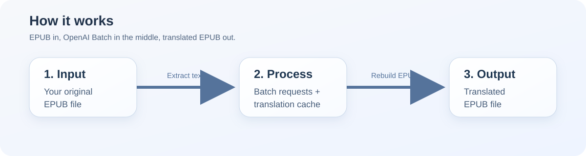

# translate-epub-ai

Translate EPUB books with OpenAI or Anthropic in a simple, copy-paste friendly way.

[Leer en español](README.es.md)



## The shortest version

If you only want the fast path:

1. Install the project.
2. Set your API key.
3. Run one command.

```bash
pip install -e .
python -m translate_epub_ai "book.epub" --to es
```

Output:

```text
book_ES.epub
```

## What this tool does

You give it an EPUB file.

It will:

- open the EPUB safely
- find the human-readable text
- send translation jobs through a batch API
- keep the original EPUB structure
- generate a translated EPUB
- save progress so you can resume later

## What you need

- Python 3.10 or newer
- an OpenAI API key or an Anthropic API key

## Install

Open a terminal in the project folder and run:

```bash
pip install -e .
```

## Set your API key

OpenAI in PowerShell:

```powershell
$env:OPENAI_API_KEY="your_api_key_here"
```

Anthropic in PowerShell:

```powershell
$env:ANTHROPIC_API_KEY="your_api_key_here"
```

OpenAI in Command Prompt (`cmd`):

```cmd
set OPENAI_API_KEY=your_api_key_here
```

Anthropic in Command Prompt (`cmd`):

```cmd
set ANTHROPIC_API_KEY=your_api_key_here
```

macOS / Linux:

```bash
export OPENAI_API_KEY="your_api_key_here"
```

Anthropic on macOS / Linux:

```bash
export ANTHROPIC_API_KEY="your_api_key_here"
```

## Translate your first book

Basic example:

```bash
python -m translate_epub_ai "book.epub" --to es
```

Example with a real model:

```bash
python -m translate_epub_ai "book.epub" --to es --model gpt-5.6-terra
```

Anthropic example:

```bash
python -m translate_epub_ai "book.epub" --provider anthropic --model claude-sonnet-5-5 --to es
```

## Useful commands

Prepare everything but do not send the batch yet:

```bash
python -m translate_epub_ai "book.epub" --to es --prepare-only
```

Resume a batch you already created:

```bash
python -m translate_epub_ai "book.epub" --resume-batch-id batch_123
```

Important:

- if you do not set `--provider`, it still uses `openai`
- `python -m translate_epub_ai` is the recommended direct command
- cache and resume still work so translated segments are not requested again

Use a custom prompt file:

```bash
python -m translate_epub_ai "book.epub" --to es --prompt-file my_prompt.txt
```

Automatic repair is enabled by default:

- after the main translation batch, the tool runs an editorial review pass over translated blocks
- after the main translation batch
- the tool looks for suspicious fragments
- it automatically re-translates only those fragments
- then it builds the final EPUB

So in normal use, you do not need to manually review the whole book just to trigger repairs.

Repair only specific bad phrases or paragraphs:

```bash
python -m translate_epub_ai "book.epub" --to es --repair-file repair.json
```

Example `repair.json`:

```json
[
  "The original English sentence that needs a better translation.",
  {
    "source_text": "A difficult paragraph from the source book.",
    "context_hint": "This section is technical and should sound precise but natural."
  }
]
```

## Want better translation style?

The default prompt lives here:

```text
src/translate_epub_ai/prompts/default_prompt.txt
```

You can:

- edit that file directly
- pass your own file with `--prompt-file`

This means you can improve tone, style, and fluency without changing Python code.

If some translated lines still look broken, awkward, or unnatural, the tool now tries to repair suspicious fragments automatically in the same translation run.

`--repair-file` is still available as an advanced option when you want to force selective retries for exact source fragments.

You can also control the built-in review stage:

```bash
python -m translate_epub_ai "book.epub" --to es --review-passes 1
```

## Translate locally with Ollama (free, no API key)

1. Install Ollama: <https://ollama.com/download> (Windows: `winget install Ollama.Ollama`).
2. Download a model, for example:

```bash
ollama pull gemma4:26b-a4b-it-qat
```

3. Translate:

```bash
python -m translate_epub_ai "book.epub" --provider ollama --glossary glossaries/the-beginning-of-infinity.es.txt --to es
```

Notes:

- Requests run one by one on your machine, so a full book can take hours. Progress and an ETA are printed as it goes.
- If the run stops, launch the same command again: finished paragraphs are in the progress cache and are not translated twice.
- `--review-passes 0` skips the second editorial pass and halves the time.
- `--glossary glossaries/the-beginning-of-infinity.es.txt` forces consistent terminology. Only terms present in each request are sent. Write your own glossary for other books (one `source = translation` per line).
- Recommended model for a 16 GB GPU: `gemma4:26b-a4b-it-qat` (mixture-of-experts, ~4B active parameters, so it is fast). On smaller GPUs use `gemma4:12b`. Thinking is disabled automatically for speed.
- For Spanish, the prompt adds concrete style rules (« » quotes, pronominal passives, no dropped qualifiers, no calques) and quotes are normalised to « » automatically.
- Optional environment variables: `OLLAMA_HOST` (default `http://localhost:11434`), `OLLAMA_NUM_CTX` (default `16384`), `OLLAMA_TEMPERATURE` (default `0.3`).

## Glossaries (any book)

A glossary keeps key terms consistent across the whole book.

```bash
# 1. Build a starting glossary for this book and stop so you can review it
python -m translate_epub_ai "book.epub" --provider ollama --to es --glossary-only
# 2. Edit book.glossary.es.txt, then translate with it
python -m translate_epub_ai "book.epub" --provider ollama --to es --auto-glossary
```

`--auto-glossary` finds candidate terms locally (words the author emphasises, capitalised concept names, recurring phrases) and asks the model which ones are real terms and how to translate them. If the glossary file already exists it is reused, so your edits are kept.

Format, one entry per line (`#` starts a comment):

```text
hard to vary = difícil de variar
reach = alcance | the range of situations an idea applies to, not "reach out"
```

The part after `|` tells the model the sense in which the rendering applies, for words that also have an everyday meaning. Only the terms present in each request are sent. `glossaries/the-beginning-of-infinity.es.txt` is a hand-made example.

## Review: where the weak spots are

After the first pass, a local checker (no model calls) looks for weak spots and only those paragraphs are reviewed (`--review-scope flagged`, the default). It flags:

- inline formatting markers that do not match the source;
- paragraphs much shorter or longer than usual for this book (possible omission or paraphrase);
- words left identical to the source (untranslated fragments);
- numbers missing or changed; a very different number of sentences (dropped or merged content);
- repeated words, unbalanced quotes or brackets, glossary terms not used;
- paragraphs that open by referring back to the previous one ("This…", "But…", "So…"): the seams where coherence can break;
- items where the translator model itself reported a doubt.

The reviewer receives the source, the current translation, the approved translation of the previous paragraph (to check the paragraph reads as a continuation) and the reasons for the flag. Use `--review-scope all` to review everything, `--review-passes 0` to skip it, and `--review-existing` to run the review on a book that is already translated.

## Citations, bibliography and index

- Titles of cited works and people's names are never translated.
- Bibliography / further-reading sections are detected (by file name or heading, in several languages): authors, titles, publishers and dates stay as in the original.
- Alphabetical index entries are translated as index terms, keeping names and numbers. `--skip-index` leaves the index untranslated to save time.

## API providers

- Defaults: `gpt-5.6-terra` (OpenAI) and `claude-sonnet-5-5` (Anthropic). Cheaper options: `--model gpt-5.6-luna` or `--model claude-haiku-5-5`.
- Prompt caching: the fixed instructions are sent first and identically in every request (OpenAI `prompt_cache_key`, Anthropic `cache_control`), so they are billed at the cached rate after the first request. Ollama reuses the same prefix to skip re-reading it.
- For OpenAI GPT-5.6 models, hidden reasoning is turned off (`--reasoning-effort none`), as translation does not need it and it is billed as output. Pass `--reasoning-effort low` (or `default`) to change it.

## How text is sent to the model

Each paragraph or heading is translated as one unit. Inline formatting is replaced by numbered markers so the model sees the whole sentence:

```text
<p>The <em>principle</em> was key.<sup><a href="#n1">12</a></sup></p>
-> "The <1>principle</1> was key.<2/>"
```

The model may move markers to follow Spanish word order; they are mapped back onto the original tags afterwards. Translations whose markers do not match the source are rejected and retried.

## Run tests

```bash
python -m unittest discover -s tests -v
```

## Project layout

```text
src/translate_epub_ai/cli.py
src/translate_epub_ai/epub.py
src/translate_epub_ai/segments.py
src/translate_epub_ai/quality.py
src/translate_epub_ai/glossary_builder.py
src/translate_epub_ai/batch_providers.py
src/translate_epub_ai/prompting.py
tests/
```

## What each file does

- `cli.py`: command-line entry point
- `epub.py`: extract and rebuild EPUB files
- `batch_providers.py`: provider logic for OpenAI and Anthropic (batch APIs) and Ollama (local)
- `segments.py`: split chapters into paragraphs, map inline markup to markers and back, detect bibliography/index sections
- `quality.py`: local weak-spot detection that decides which paragraphs get reviewed
- `glossary_builder.py`: `--auto-glossary` candidate extraction and generation
- `prompting.py`: generate the translation prompt
- `tests/`: keep refactors safer

## Included tests

This repo currently checks:

- prompt generation
- batch grouping logic
- prompt quality using a difficult passage from *The Beginning of Infinity*

## Troubleshooting

If you see `OPENAI_API_KEY is not set`, set the environment variable first.

If you are using Anthropic, set `ANTHROPIC_API_KEY` instead and add:

```bash
--provider anthropic
```

If you want to inspect the generated batch files before sending them, use:

```bash
python -m translate_epub_ai "book.epub" --to es --prepare-only
```

If you want to change the translation style, start by editing:

```text
src/translate_epub_ai/prompts/default_prompt.txt
```
